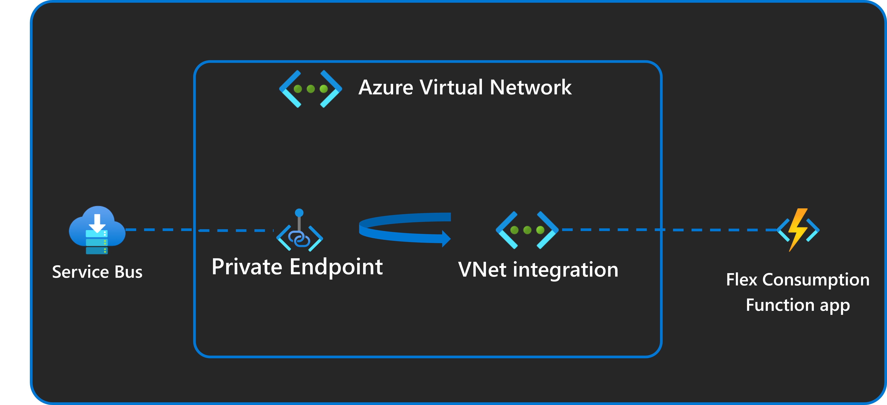

# Azure Functions quickstart with Service Bus trigger (Java)

A common scenario that Azure Functions can be used for is for the processing of queue based events. For example, a list of batch processing jobs is queued up with instructions for machine learning processing. The function app can do some ML inferencing before completing the message in the queue.

This sample demonstrates a function app running in a Flex Consumption plan that connects to Service Bus running in a virtual network. This sample demonstrates these two key features of the Flex Consumption plan:

* **High scale**. `maxConcurrentCalls` is set to 1 in `host.json`, with a 30-second processing delay. The app can scale out as messages accumulate, up to the configured maximum of 100 instances; an instance is not guaranteed for every message.
* **Virtual network integration**. With `VNET_ENABLED=true`, Service Bus and storage public access is disabled and the function app uses VNet integration and private endpoints. The quickstart uses `false` so you can run locally. In either mode, the deployed app uses managed identity instead of connection strings for Service Bus and storage.



> [!IMPORTANT]
> This sample creates several resources. Make sure to delete the resource group after testing to minimize charges!

## Prerequisites

Before you can run this sample, you must have the following:

* An Azure subscription  
* Java 17 or later
* [Maven 3.6 or later](https://maven.apache.org/download.cgi)
* Ensure both Microsoft.Web and Microsoft.App are [registered resource providers on the Azure subscription](https://learn.microsoft.com/azure/azure-resource-manager/management/resource-providers-and-types#register-resource-provider)
* [Azure CLI](https://learn.microsoft.com/cli/azure/install-azure-cli)
* [Azure Functions Core Tools](https://learn.microsoft.com/azure/azure-functions/functions-run-local?tabs=v4%2Clinux%2Cjava%2Cportal%2Cbash#install-the-azure-functions-core-tools)
* [Azure Dev CLI](https://learn.microsoft.com/azure/developer/azure-developer-cli/install-azd?tabs=winget-windows%2Cbrew-mac%2Cscript-linux&pivots=os-windows)
* Bash on Linux/macOS, or PowerShell 7 on Windows, for the post-provision hook
* Permission to create resources and role assignments in the target subscription

> **Note:** This is a Java Azure Functions project. The Maven `pom.xml` file and Java source code are located in the `src/` directory to align with Azure Developer CLI expectations for Java functions.

## Initialize the local project

You can initialize a project from this `azd` template in one of these ways:

* Use this `azd init` command from an empty local (root) folder:

  ```shell
  azd init --template functions-quickstart-java-azd-service-bus
  ```

  Supply an environment name, such as `flexquickstart` when prompted. In `azd`, the environment is used to maintain a unique deployment context for your app.

* Clone the GitHub template repository locally using the `git clone` command:

  ```shell
  git clone https://github.com/Azure-Samples/functions-quickstart-java-azd-service-bus.git
  cd functions-quickstart-java-azd-service-bus
  ```

  You can also clone the repository from your own fork in GitHub.

## Authenticate to Azure

Sign in with both the Azure Developer CLI and Azure CLI. The generated message sender uses `az rest`, which requires a separate Azure CLI sign-in.

```shell
azd auth login
az login
```

Use the intended subscription when `azd` prompts you during provisioning. The generated sender explicitly targets that subscription without changing the Azure CLI default.

## Provision Azure resources

1. Run the following command to provision all required Azure resources:

  ```shell
  azd provision
  ```

  You're prompted to supply these required deployment parameters:

  | Parameter | Description |
  | ---- | ---- |
  | _Environment name_ | An environment that's used to maintain a unique deployment context for your app. You won't be prompted if you created the local project using `azd init`. |
  | _Azure subscription_ | Subscription in which your resources are created. |
  | _Azure location_ | Azure region in which to create the resource group that contains the new Azure resources. Only regions that currently support the Flex Consumption plan are shown. |
  | _VNET_ENABLED_ | Whether to deploy with VNet integration and private endpoints. Enter `false` for this quickstart. |

  This creates all necessary Azure resources including:

* Azure Service Bus namespace and queue
* Azure Function App (Flex Consumption)
* Application Insights for monitoring
* Storage account for function app
* Virtual network with private endpoints (if `VNET_ENABLED=true`)

  The deployer's data-role assignments default to principal type `User`; the function's managed identity uses `ServicePrincipal`. For service-principal deployments, run `azd env set AZURE_PRINCIPAL_TYPE ServicePrincipal` before provisioning.

  After provisioning completes, the post-provision hook creates `src/local.settings.json` only if it doesn't exist. An existing file is preserved byte-for-byte, not validated, and the hook prints the namespace and queue values to review manually. It does not print existing settings or secrets. A newly created file contains:
 z

  ```json
  {
    "IsEncrypted": false,
    "Values": {
      "AzureWebJobsStorage": "UseDevelopmentStorage=true",
      "FUNCTIONS_WORKER_RUNTIME": "java",
      "ServiceBusConnection__fullyQualifiedNamespace": "<your-namespace>.servicebus.windows.net",
      "ServiceBusQueueName": "<your-queue-name>"
    }
  }
  ```

  Local execution uses your developer credentials from `az login`, not the deployed app's managed identity. If reusing existing settings, review any `ServiceBusConnection` connection string or `ServiceBusConnection__credential` and `ServiceBusConnection__clientId` values that could override developer authentication.

## Prepare local dependencies

1. Navigate to the `src` folder and restore/build the Java project:

  ```shell
  cd src
  mvn clean package
  ```

## Run your app locally

Use `VNET_ENABLED=false` for local execution unless your machine has connectivity and DNS resolution to the private endpoints. Don't run the local host while verifying the deployed app: both hosts consume from the same queue.

1. Start the Azurite storage emulator. You can do this using the [Azurite extension](https://marketplace.visualstudio.com/items?itemName=Azurite.azurite) in VS Code or by running `azurite` in a separate terminal.

1. From the `src` folder, run this command to start the Functions host locally:

  ```shell
  mvn azure-functions:run
  ```

1. The function starts and displays the available functions. You should see output similar to:

  ```output
  Functions:
    serviceBusQueueTrigger - [serviceBusTrigger]
  ```

1. When you're done, press Ctrl+C in the terminal window to stop the host process.

## Run your app using Visual Studio Code

1. Open the `src` folder in Visual Studio Code so its Java launch configuration and Maven tasks are used.
1. Start the Azurite storage emulator.
1. Press **Run/Debug (F5)** to run in the debugger.
1. The Azure Functions extension starts the local runtime.

## Source Code

The Service Bus trigger function is defined in [`src/main/java/com/example/ServiceBusFunction.java`](./src/main/java/com/example/ServiceBusFunction.java). The trigger concurrency setting is in [`src/host.json`](./src/host.json).

## Deploy to Azure

Run this command to deploy your function app code to Azure:

```shell
azd deploy
```

Run `azd` commands from the repository root, not `src`. To provision and deploy together, use `azd up`.

## Test the solution

1. From the repository root, with the function running (either locally or deployed to Azure), send a test message to the Service Bus queue by running the generated script:

  ```shell
  ./send-message.sh
  ```

  On Windows (PowerShell):

  ```powershell
  .\send-message.ps1
  ```

1. For local execution, you should see output in the function terminal similar to:

  ```output
  [2026-01-01T10:30:15.123Z] Java ServiceBus Queue trigger start processing a message: Hello from the CLI
  [2026-01-01T10:30:45.123Z] Java ServiceBus Queue trigger end processing a message
  ```

1. For Azure execution, stop the local host and check Application Insights for a successful `serviceBusQueueTrigger` invocation and the start/end processing logs. Verify that the queue drains with no dead-letter messages. To observe scaling, send multiple messages and check live metrics.

With `VNET_ENABLED=true`, sending from a public machine (including Service Bus Explorer) is blocked. Send from a client inside the VNet, or one with private connectivity and DNS. Adding a firewall IP alone does not permit access while public network access is disabled. If you temporarily enable restricted public access for a test sender, restore the original network settings immediately afterward; that is a public send followed by private function processing, not an entirely private end-to-end test.

## Redeploy your code

Run `azd deploy` to deploy code updates. If you need to update infrastructure, run `azd provision` again.

> [!NOTE]
> Deployed code files are always overwritten by the latest deployment package.

## Clean up resources

When you no longer need the resources created in this sample, run the following command to delete the Azure resources:

```bash
azd down
```

## Resources

For more information on Azure Functions, Service Bus, and VNet integration, see the following resources:

* [Azure Functions documentation](https://docs.microsoft.com/azure/azure-functions/)
* [Azure Service Bus documentation](https://docs.microsoft.com/azure/service-bus/)
* [Azure Virtual Network documentation](https://docs.microsoft.com/azure/virtual-network/)
